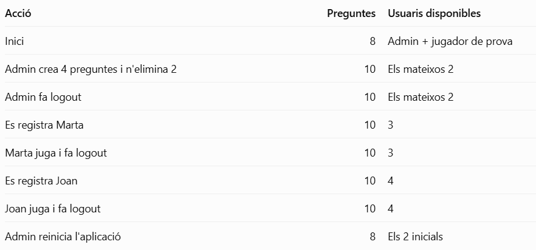

# Pe1: Instruccions d'examen

Us he proporcionat una plantilla HTML i CSS amb les pantalles maquetades i un fitxer `dades.php` amb les preguntes i els usuaris inicials. **La vostra feina serà fer que tot funcioni amb PHP de manera DINÀMICA. Podeu modificar i reorganitzar els fitxers segons les vostres necessitats.**

## Abans de començar

Dins del projecte Docker habitual, creeu la carpeta:

`src/examens/pe1/`

Col·loqueu-hi els fitxers proporcionats i desenvolupeu-hi l'aplicació. No cal configurar Docker de nou. Així evitem problemes amb containers inesperats.....

## Què ha de fer l'aplicació?

### 1. Registre i login

L'aplicació tindrà dos rols: _administrador_ i _jugador_.

Els usuaris nous s'han de poder registrar amb un nom d'usuari i una contrassenya, que hauran de repetir per confirmar-la. No es poden registrar noms d'usuari duplicats ni deixar camps buits.

Les contrasenyes s'han de guardar amb `password_hash()` i comprovar amb `password_verify()`.

Quan un usuari inicia sessió, ha d'accedir a la zona que li correspon segons el seu rol. Si les credencials són incorrectes, ha de poder tornar-ho a intentar. També heu de contemplar que ningú pugui arribar directe desde la url sense passar per LOGIN...

Els usuaris registrats des del formulari sempre tindran el rol de _jugador_

### 2. Administració de preguntes

L'administrador tindrà una zona privada des d'on podrà gestionar les preguntes del Trivial. SI NO ES ADMIN NO PODRÀ FER RES MÉS QUE LLEGIR

Ha de poder:

- Consultar totes les preguntes.
- Crear preguntes noves.
- Editar preguntes existents.
- Eliminar preguntes.

Cada pregunta tindrà una categoria, un enunciat, quatre opcions i una resposta correcta.

Les preguntes han de tenir un identificador i no es poden guardar incompletes. Els canvis que faci l'administrador s'han de conservar i han d'aparèixer després al joc.

### 3. El joc

Un jugador que hagi iniciat sessió podrà començar una partida individual.

El Trivial mostrarà una pregunta cada vegada, indicant la categoria i les quatre opcions disponibles.

Quan respongui:

- **Si encerta**, suma un punt i passa a la pregunta següent.
- **Si falla**, es mostra un avís i continua a la mateixa pregunta fins que l'encerti.

Durant la partida s'ha de mostrar el nom del jugador, la puntuació i el progrés.

Les preguntes ja superades no s'han de repetir i tampoc no s'ha de poder sumar més d'un punt per pregunta.

Quan s'acabin les preguntes, s'ha de mostrar el resultat final i permetre començar una partida nova.

No cal que les preguntes surtin aleatòriament ni que el jugador pugui escollir categoria.

### 4. Sessions

Tota la informació es conservarà amb `$_SESSION`: usuaris registrats, preguntes, usuari identificat i progrés de la partida. Podeu crear les sessions que considereu, tants calaixos com vulgueu, i les funcions d'arrays que creieu.... ARRAY VALUES, ARRAY PUSH, ARRAY POP.... hi ha vàries molt útils

Cal incloure un logout que tanqui l'accés de l'usuari i esborri el seu progrés, però que mantingui les preguntes i els usuaris registrats.&#x20;

També heu de controlar els permisos: un jugador no pot entrar a les pàgines de l'administrador ni executar les seves accions, encara que conegui l'URL.

## He de maquetar tot desde zero????? :(((

No. Al ZIP teniu:

- Plantilles HTML i CSS de les diferents pantalles.
- Un array amb **8 preguntes de cultura general**, repartides en 4 categories.
- Dos usuaris de prova: administrador i jugador.

Les plantilles són ESTATIQUES. Haureu d'adaptar els formularis, els enllaços i el contingut perquè treballin amb PHP.&#x20;

EL LOGOUT NO ÉS tan fàcil com sempre...

### Exemple de funcionament:

Entra l'administrador

Crea 4 preguntes i n'elimina 2.
8 inicials
ARA: 10 preguntes

L'administrador fa logout

S'elimina la seva autenticació, però continuen existint les 10 preguntes.

Entra el jugador 1

Juga amb les 10 preguntes. Quan acaba, tanca sessió.

Entra el jugador 2

Troba les mateixes 10 preguntes i comença una partida nova amb puntuació zero.

Es reinicia l'aplicació

Es destrueix la sessió completa. En tornar a entrar, l'aplicació recupera els dos usuaris de prova i les 8 preguntes inicials.

Molta sort a tothom!!! 😊
